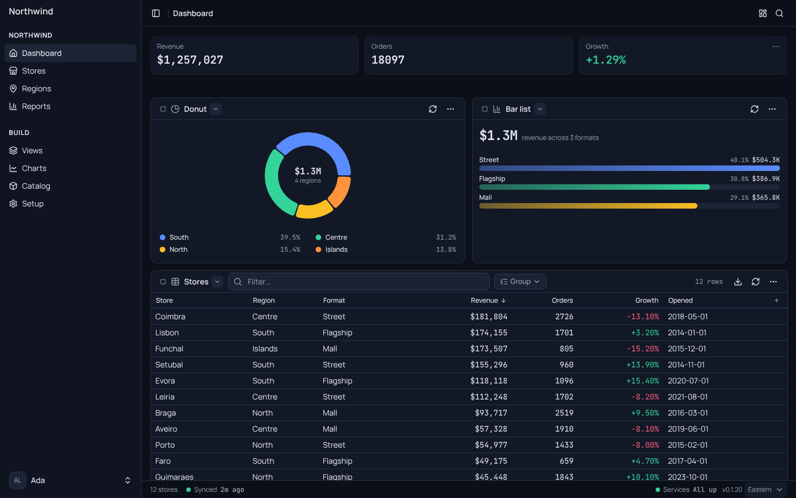
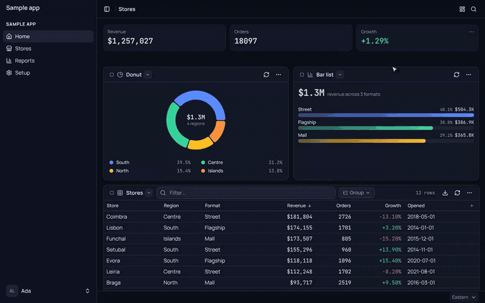
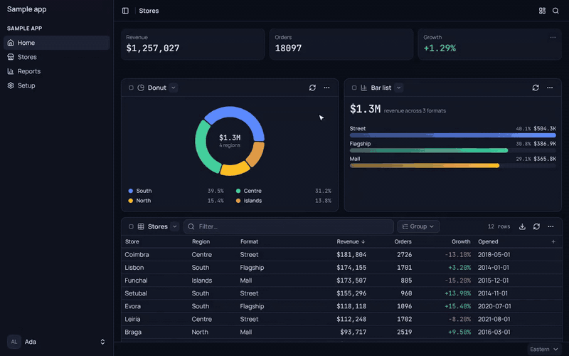

<div align="center">

# Lumen

**Columen Labs' shared building blocks for apps**, published as `@columenlabs/lumen-*`. Today that is a React component system for data apps (an app frame, data-driven pages and views, widgets, charts, drawers and pickers on one theme), its view model and the release kit. Shared backend parts join as they move out of the apps that run them.

[](https://www.npmjs.com/package/@columenlabs/lumen-ui)
[](LICENSE)
[](https://lumen.columenlabs.com/docs/)
[](https://ui.shadcn.com)

[**Docs**](https://lumen.columenlabs.com/docs/) · [**llms.txt**](https://lumen.columenlabs.com/llms.txt) · [**Changelog**](https://github.com/columenlabs/lumen/releases) · [**Packages**](#packages)



<sub>A made-up sample app: everything on screen is Lumen.</sub>

</div>

## Packages

One repo holds the Lumen family. Each folder `packages/<name>` is published as `@columenlabs/lumen-<name>`, and every package ships at the same version from one release, so an app pins one number for all of them.

| Folder | Package | What it holds | Status |
|---|---|---|---|
| [`packages/ui`](packages/ui) | [`@columenlabs/lumen-ui`](https://www.npmjs.com/package/@columenlabs/lumen-ui) | The components, the shadcn parts under `ui/*`, and `theme.css` | Published |
| [`packages/ui-types`](packages/ui-types) | [`@columenlabs/lumen-ui-types`](https://www.npmjs.com/package/@columenlabs/lumen-ui-types) | The view model: view config, formulas, domains and joins, the data catalog, frames, chart formulas. No React | Published |
| [`packages/ship`](packages/ship) | [`@columenlabs/lumen-ship`](https://www.npmjs.com/package/@columenlabs/lumen-ship) | Release notes written by Claude, the changelog What's new reads, lint guards | Published |
| `packages/auth` | `@columenlabs/lumen-auth` | Sign-in checks: access tokens, service tokens, OAuth for MCP servers | Planned |
| `packages/ops` | `@columenlabs/lumen-ops` | Usage meters, page-error logs, email, signed webhooks | Planned |
| `packages/ai` | `@columenlabs/lumen-ai` | MCP server helpers; later a product-neutral assistant | Planned |
| `packages/vault` | `@columenlabs/lumen-vault` | Per-person sealing and a per-person Durable Object base with module migrations, alarms, backup and wipe | Planned |

A planned package has no folder until its first code moves in. Each package's own README says what it exports and how to use it.

### What may join

A part becomes a Lumen package only when all four hold:

1. Two or more apps run it.
2. It names no product (the kit is neutral: apps pass their names and data in through `configureLumen` and `registerDomains`).
3. It moves from working code in an app, never written fresh here.
4. It owns no app's data: it gives the shapes and the machinery, the app keeps its rows.

## For coding agents

- [`llms.txt`](https://lumen.columenlabs.com/llms.txt): what Lumen is, each package, and links to the rest.
- [`llms-full.txt`](https://lumen.columenlabs.com/llms-full.txt): every README plus every component's props and an example, in one file.
- [Component manifest](https://lumen.columenlabs.com/docs/manifests/components.json) (JSON). `bun run --filter=lumen-docs dev` also serves Storybook's MCP at `http://localhost:6006/mcp`.

## The UI kit at a glance

| | Part | What it does |
|---|---|---|
| 🪟 | **App shell** | `LumenShell`: sidebar (icons-only collapse, a drawer on phone), header, status bar, Settings, profile menu and ⌘K Find |
| 🧱 | **Blocks** | `LumenLayout` and `LumenGrid` (a page of cards you can rearrange), `LumenWidget` (a card with its header, link square and controls), sign-in and Security, Settings sections, tabs |
| 📊 | **Views and charts** | `LumenView` and `LumenTable` (filter, group, pivot, totals), `LumenCard`, `LumenChart`, `LumenEChart`, price and growth charts |
| 🎛️ | **Pickers and panels** | `LumenSelector`, `LumenDrawer`, `LumenConfirm`, `LumenForm`, `LumenDateInput`, `LumenTabs` |
| 🧩 | **Primitives** | The shadcn/ui parts under `ui/*` and `theme.css` |

Install and use: [packages/ui/README.md](packages/ui/README.md).

### Pages people can rearrange

Give `LumenLayout` an `onConfigChange` and every page can be changed by the person using it: **Edit layout** moves and sizes the widgets on a 6-column grid, and each widget's **Edit widget** changes its type, fields and controls. Both write back into the view config.

| Edit layout | Edit widget |
|---|---|
|  |  |

Try both live on the docs' [Edit layout](https://lumen.columenlabs.com/docs/?path=/docs/blocks-edit-layout--docs) and [Edit widget](https://lumen.columenlabs.com/docs/?path=/docs/blocks-edit-widget--docs) pages.

> **Status: 0.x.** Any minor version may break things until 1.0.

## Develop

```bash
bun install
bun run lint && bun run type-check && bun run build   # build writes out/<package> and docs/dist
bun run --filter=lumen-docs dev                       # the docs at http://localhost:6006
```

The docs site (`docs/`) is Storybook over the kit's source plus the files agents read. `docs/wrangler.jsonc` serves `docs/dist` at lumen.columenlabs.com:

| Path | What |
|---|---|
| `/docs/` | Storybook: every component on sample data, with Controls and Show code |
| `/llms.txt` | The index for agents ([llmstxt.org](https://llmstxt.org) format) |
| `/llms-full.txt` | Every README and every component's props in one file |
| `/<package>.md` | Each package's README (`/ui.md`, `/ui-types.md`, `/ship.md`) |

All of it is built from the READMEs and the stories (`docs/scripts/llms.ts`), so nothing is written twice. Add or change a story in `docs/stories/` with the part, and keep each package's README current with its exports.

To try a change inside an app before it is published, use `bun link` in `out/<package>` and `bun link @columenlabs/lumen-ui` in the app.

## Releases

Every merge to `main` publishes every package at the next patch version and tags it ([publish.yml](.github/workflows/publish.yml)), with notes on what changed in each release: see the [releases](https://github.com/columenlabs/lumen/releases). A new minor is cut only by hand (Run workflow with bump = minor).

## License

MIT, see [LICENSE](LICENSE). Third-party notices are in [NOTICE](NOTICE).
